# แล็บสัปดาห์ที่ 13: Modern Data Warehouse และ AI Analytics

รหัสนักศึกษา: 67160175

โจทย์ธุรกิจ: ร้านกาแฟ Coast Café (ข้อมูลสังเคราะห์ ก.ค. ถึง ก.ย. 2026)

ไฟล์ SQL: 67160175.sql (คำตอบ A1 ถึง C2 มี comment กำกับ)

## ส่วน A: ทบทวน SQL

| ข้อ | ผลที่ได้ |
|---|---|
| A1 | แสดง 10 แถวแรกได้ถูกต้อง |
| A2 | รายการ Completed ช่องทางออนไลน์ล่าสุดคือ O0092 (29 ก.ย. 2026) |
| A3 | เครื่องดื่ม 4 รายการ เบเกอรี 2 รายการ อาหาร 2 รายการ |
| A4 | JOIN orders กับ products ได้ 240 แถว ทุกคำสั่งซื้อจับคู่กับสินค้าได้ |
| A5 | ยอดขายสุทธิตามจังหวัด: ฉะเชิงเทรา 17,879.30 บาท, ชลบุรี 9,518.60, ระยอง 7,374.60, กรุงเทพฯ 2,807.75 |
| A6 | ยอดขายสุทธิตามหมวดสินค้า: เครื่องดื่ม 16,694.50, เบเกอรี 10,829.10, อาหาร 10,056.65 |
| A7 | ลูกค้า 5 อันดับแรก: C008 (1,734.10), C039 (1,557.70), C031 (1,483.05), C020 (1,467.00), C026 (1,451.95) |
| A8 | สินค้า 7 รายการที่มียอดขายทำรายได้เกิน 2,000 บาท สูงสุดคือเค้กช็อกโกแลต 6,895.35 บาท |

## ส่วน B: Modern Data Warehouse

### B1 โครงสร้าง Star Schema

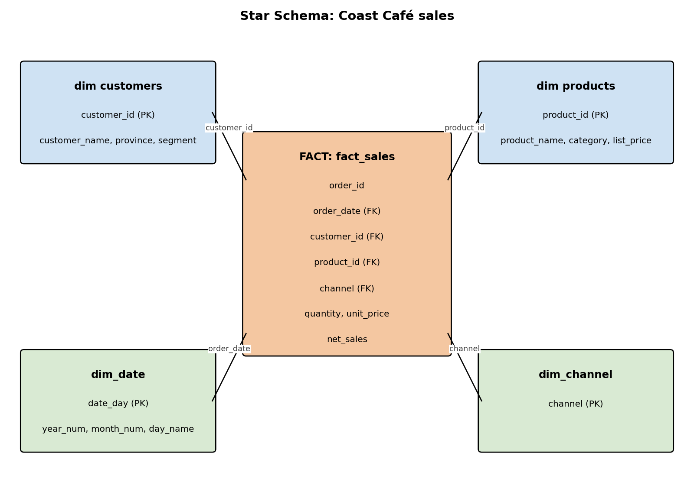

ตาราง fact คือ fact_sales ส่วน dimension ได้แก่ customers, products, dim_date และ dim_channel คีย์ที่ใช้เชื่อมคือ customer_id, product_id, order_date และ channel

fact เก็บค่าตัวเลข เช่น ยอดขายและจำนวน ส่วน dimension เก็บบริบท เช่น ใครเป็นผู้ซื้อ ซื้อสินค้าอะไร ซื้อเมื่อไร และซื้อผ่านช่องทางใด

### B2 Data Mart

mart_monthly_sales สรุปรายได้รายเดือนตามหมวดสินค้าและช่องทาง มี 27 แถว สร้างด้วย DATE_TRUNC('month', ...) และใช้ทำรายงานได้ทันที

### B3 ตรวจคุณภาพข้อมูล

| การตรวจสอบ | จำนวนแถวที่พบ |
|---|---|
| customer_id หายหรือไม่พบในตาราง customers | 0 |
| quantity น้อยกว่าหรือเท่ากับ 0 หรือมากกว่า 20 | 0 (ค่าจริงอยู่ระหว่าง 1 ถึง 4) |
| product_id ที่ไม่พบในตาราง products | 0 |

โครงสร้างข้อมูลสะอาดดี แต่มีคำสั่งซื้อ 15 รายการที่สถานะเป็น Cancelled ซึ่ง fact_sales กรองออกให้แล้ว

## ส่วน C: AI Analytics

### C1 Time Series

หน้าต่าง AVG(...) OVER (ORDER BY order_date ROWS BETWEEN 6 PRECEDING AND CURRENT ROW) ใช้ 7 แถวข้อมูล ไม่ใช่ 7 วันตามปฏิทิน เพราะวันที่ไม่มียอดขายจะไม่มีแถว ทำให้บางช่วงครอบคลุมมากกว่า 7 วัน ถ้าต้องการ 7 วันจริง ให้สร้างปฏิทินวันที่ครบด้วย generate_series แล้ว LEFT JOIN กับยอดขายรายวันก่อนคำนวณค่าเฉลี่ย

### C2 Customer Features

ได้ features ครบทั้ง 40 ลูกค้า ได้แก่ last_order, recency_days, frequency (จำนวนคำสั่งซื้อ) และ monetary (ยอดสุทธิ)

### C3 AI Use Case: แบ่งกลุ่มลูกค้า

- เป้าหมาย: ไม่มี label ให้ใช้ จึงใช้ clustering แบบ unsupervised หรือกำหนดกลุ่มด้วย RFM
- Features: recency_days, frequency, monetary, segment, province
- การประเมิน: ดู silhouette score ความต่างของ monetary และ frequency ระหว่างกลุ่ม และตรวจว่ากลุ่มที่ได้มีความหมายทางธุรกิจหรือไม่
- Data leakage: ถ้าสร้าง features จากยอดขายที่เกิดหลังจุดที่ต้องการทำนาย ผลจะดูดีเกินจริง จึงต้องแยกช่วงเวลาของ feature กับ label ให้ชัดเจน

## ภาพผลลัพธ์จากการรัน query

ภาพด้านล่างเป็นภาพแคปหน้าจอจาก DuckDB Web Shell (shell.duckdb.org) ที่รันคำสั่งจาก 67160175.sql ทีละข้อ A4 และ C2 แสดง 12 แถวแรก และ B2 แสดง 12 จาก 27 แถว ไฟล์ภาพอยู่ในโฟลเดอร์ results

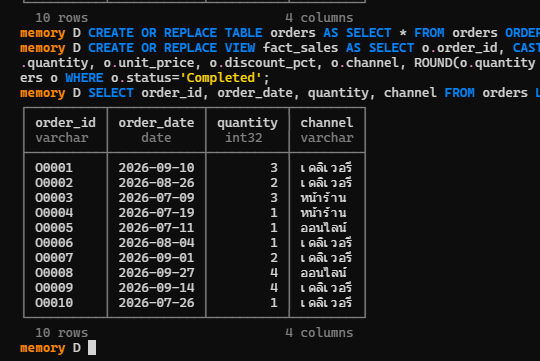

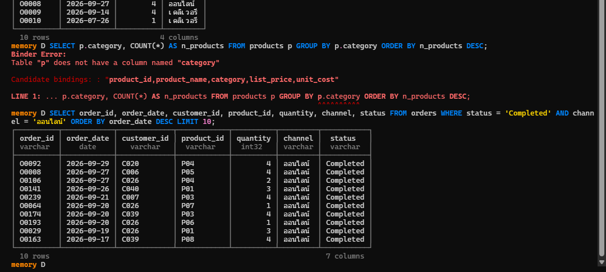

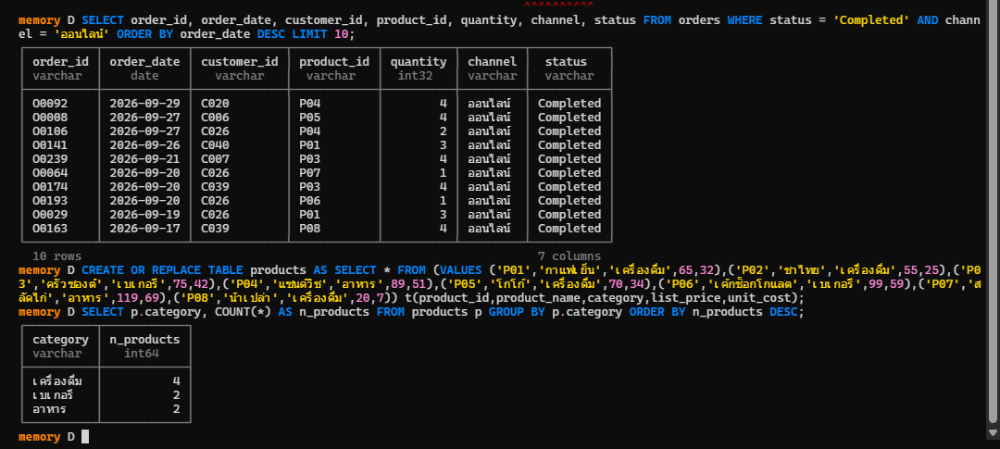

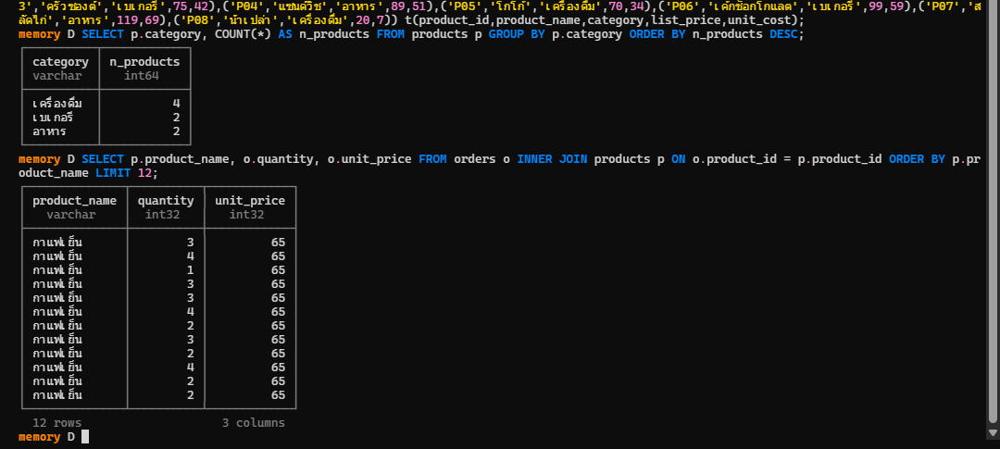

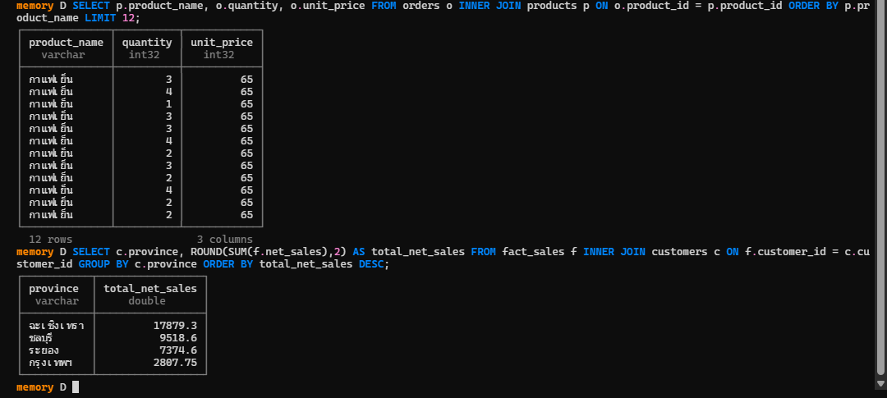

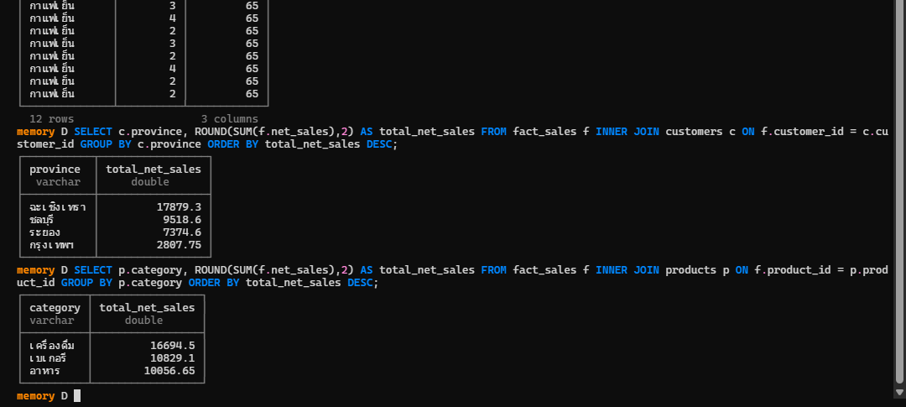

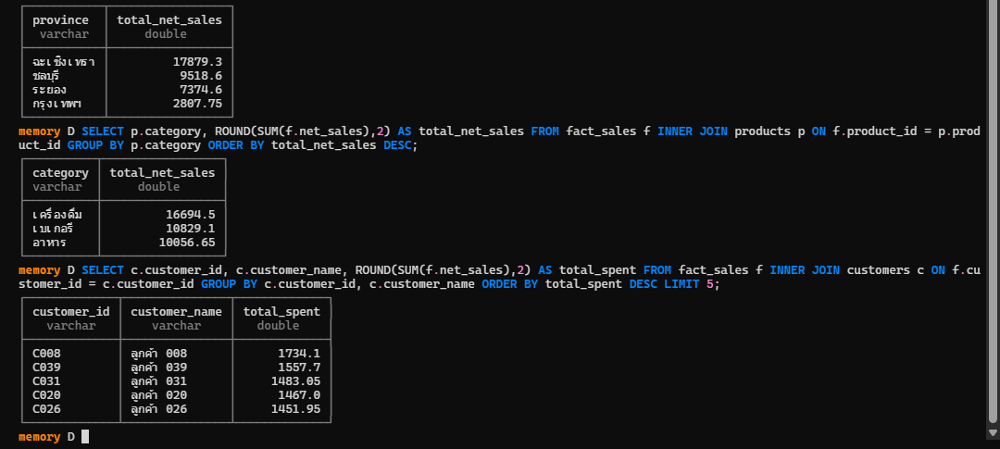

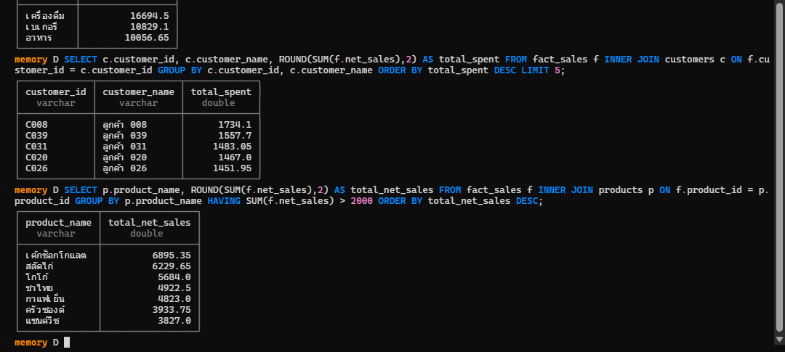

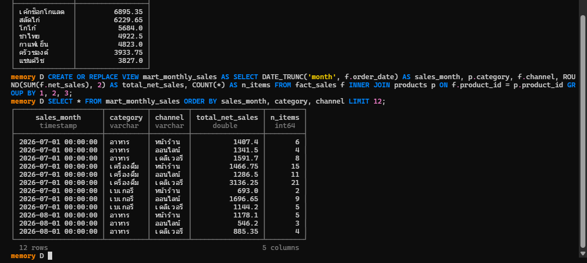

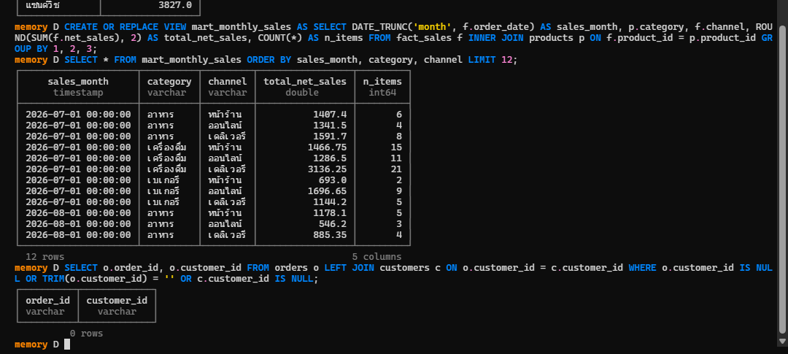

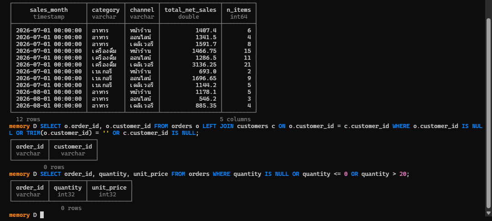

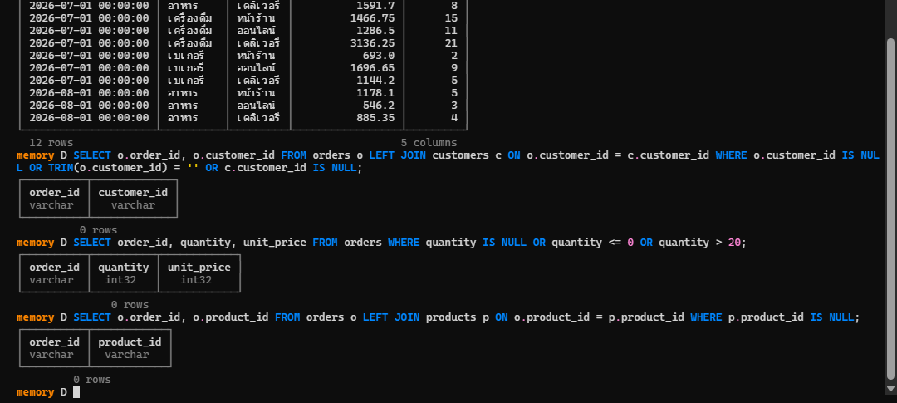

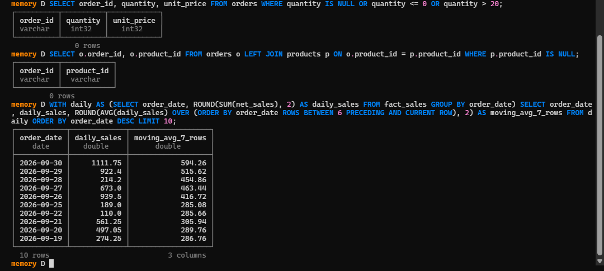

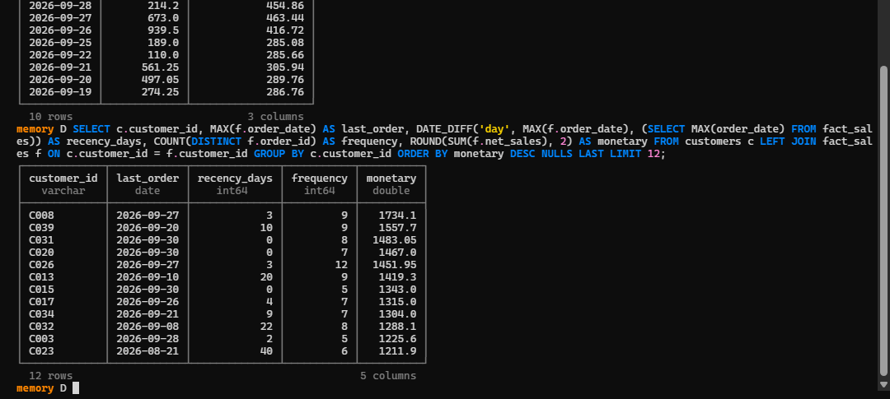

## ส่วน D: Executive Insight

1. สิ่งที่พบจาก SQL: ยอดขายสุทธิรวม 37,580.25 บาท จากออเดอร์ Completed 225 รายการ ในช่วง ก.ค. ถึง ก.ย. 2026 ยอดแยกตามช่องทางใกล้เคียงกันมาก คือ เดลิเวอรี 13,152 บาท หน้าร้าน 12,386 บาท และออนไลน์ 12,042 บาท ฉะเชิงเทรามียอดสูงสุดในระดับจังหวัด และเครื่องดื่มเป็นหมวดที่ทำรายได้สูงสุด ลูกค้า Walk-in 25 รายทำรายได้ 25,157 บาท ส่วนสมาชิก Member 15 รายทำได้ 12,423 บาท เฉลี่ยต่อรายประมาณ 1,006 บาทกับ 828 บาทตามลำดับ

2. ข้อเสนอ: ควรผลักดันเค้กช็อกโกแลตและสลัดไก่ซึ่งทำรายได้สูงสุด ทดลองแคมเปญชวนสมาชิกให้ซื้อบ่อยขึ้น เพราะยอดเฉลี่ยต่อรายของสมาชิกต่ำกว่า Walk-in และทำแคมเปญกระตุ้นลูกค้าที่ recency_days สูงให้กลับมาซื้ออีก

3. สิ่งที่ยังสรุปไม่ได้: ข้อมูลเป็นข้อมูลสังเคราะห์ที่ครอบคลุมแค่ 3 เดือน ไม่มีต้นทุนการตลาด และไม่เห็นฤดูกาลในระยะยาว ยอดของแต่ละช่องทางต่างกันไม่มาก จึงยังบอกไม่ได้ว่าช่องทางไหนดีกว่าอย่างมีนัยสำคัญ

4. ข้อควรระวังเมื่อใช้ AI: โมเดลที่เรียนจากช่วงเวลาสั้นอาจจำ pattern ชั่วคราว ต้องระวัง data leakage และควรให้ผู้เชี่ยวชาญด้านธุรกิจตรวจผลการแบ่งกลุ่มก่อนนำไปใช้จริง

## แหล่งที่มาและการตรวจสอบ

- รัน SQL ทั้งหมดด้วย DuckDB (Python package เวอร์ชัน 2.0.0) จาก 00_setup.sql และ 67160175.sql
- ตรวจผล B3 ซ้ำด้วยสคริปต์ Python ที่อ่านไฟล์ CSV โดยตรง ผลตรงกัน
- ใช้ AI (Claude) ช่วยเขียน SQL และร่างคำอธิบาย ก่อนส่งควรตรวจผลอีกครั้ง
